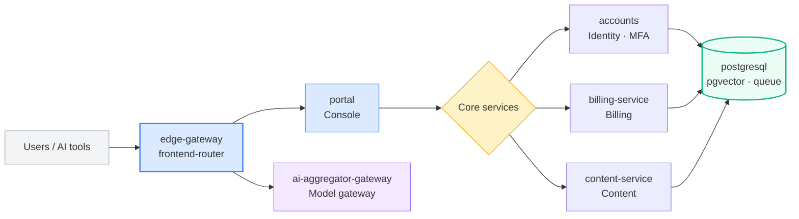

<!-- Target: ai-workspace-services/.github → profile/README.md (Chinese: profile/README_ZH.md) -->
<!-- Style mirrors ai-workspace-infra/.github profile/README.md. Spec: org-homepage-handoff.md -->

<p align="center">
  
</p>

<h1 align="center">ai-workspace-services</h1>
<p align="center"><strong>Open Cloud-Native Services for AI Workspaces | 开放的 AI 云原生服务底座</strong></p>

<p align="center">
  <a href="https://console.svc.plus"></a>
  <a href="https://github.com/ai-workspace-services"></a>
  <a href="https://github.com/ai-workspace-services?tab=repositories"></a>
  <a href="#-quick-start"></a>
  <a href="https://github.com/ai-workspace-services/accounts"></a>
</p>

<p align="center">
  <strong>🌐 English</strong> ｜ <a href="https://github.com/ai-workspace-services/.github/blob/main/profile/README_ZH.md">🇨🇳 简体中文</a>
</p>

---

## 🌐 Overview

`ai-workspace-services` is the application-services organization of AI Workspace Lab, built on top of [`ai-workspace-infra`](https://github.com/ai-workspace-infra). We combine unified identity, AI collaboration workspaces and a low-latency global network into one ready-to-use stack — use it fully managed in the cloud, or self-host it in three minutes.

### Product Principles

- **Open, no lock-in**: every service is Apache-2.0, self-hostable and portable.
- **One identity**: a single account across console, billing and every product, with GitHub / Google sign-in.
- **Latency first**: networking tuned for streaming in AI tools like Cursor, Claude and ChatGPT.
- **Multi-tenant by default**: tenant isolation, secret governance and observability out of the box.

### Quick Links

- **Console**: [console.svc.plus](https://console.svc.plus)
- **Docs & knowledge base**: [knowledge](https://github.com/ai-workspace-services/knowledge)
- **Infrastructure org**: [ai-workspace-infra](https://github.com/ai-workspace-infra)

---

## 🧩 Core Products

<table>
<tr>
<td width="33%" align="center" valign="top">
  <h3>⚡<br/><a href="https://console.svc.plus/products/xstream">XConnect</a></h3>
  <p><strong>AI Workspace Acceleration</strong></p>
  <p align="left"><sub>Lower streaming latency for AI tools. Kernel-level BBR + FQ, automatic TLS. Self-host with 1 VPS + 1 domain, or use managed SaaS.</sub></p>
</td>
<td width="33%" align="center" valign="top">
  <h3>🤖<br/><a href="https://console.svc.plus/products/xworkmate">XWorkmate</a></h3>
  <p><strong>Autonomous AI Workspace</strong></p>
  <p align="left"><sub>Persistent context for multi-step AI workflows. Multi-agent team collaboration with state tracking.</sub></p>
</td>
<td width="33%" align="center" valign="top">
  <h3>🛡️<br/><a href="https://console.svc.plus">Open-Platform Core</a></h3>
  <p><strong>Unified Identity & Multi-Tenancy</strong></p>
  <p align="left"><sub>One-click GitHub / Google OAuth, tenant isolation, secret governance and end-to-end observability.</sub></p>
</td>
</tr>
</table>

---

## 🔀 Service Architecture



---

## 🚀 Quick Start

| Path | Best for | How |
| :--- | :--- | :--- |
| ☁️ **Zero-ops cloud** | Try it now | Sign in at [console.svc.plus](https://console.svc.plus) with GitHub / Google |
| 📱 **Native client** | Daily use | [Download XConnect preview](https://console.svc.plus/products/xstream) (macOS / Windows / iOS / Linux) |
| 🖥️ **Self-hosted control plane** | Run Console, Accounts, Billing and PostgreSQL yourself | Use the reviewed SSH → Playbook → fixed GitOps → Doco-CD deployment path; see the [Selfhost deployment guide](../docs/selfhost-orchestrator-one-shell-uat-prod.md). |
| 🔌 **Proxy node** | Add one XConnect edge node to an existing control plane | 1 VPS + 1 node domain pointing to it, then run the proxy installer below. |

```bash
# Proxy node only; this does not deploy the self-hosted control plane.
curl -fsSL https://raw.githubusercontent.com/ai-workspace-services/.github/main/scripts/setup-proxy.sh \
  | bash -s -- --node xhttp.example.com
```

For the self-hosted control plane, use separate control-plane domains such as
`console-sit-v4.<base domain>`, `accounts-sit-v4.<base domain>`,
`billing-sit-v4.<base domain>`, and `postgresql-sit-v4.<base domain>`.
PostgreSQL remains tunnel-only and is never exposed as a public database.

---

## 📦 Repositories (10)

| Repository | Type | Description |
| :--- | :--- | :--- |
| [`portal`](https://github.com/ai-workspace-services/portal) | `Control Panel` | Open cloud control panel — "escape pods" from vendor lock-in |
| [`accounts`](https://github.com/ai-workspace-services/accounts) | `Identity & Auth` | Production-ready auth, MFA and agent coordination; core of svc.plus |
| [`billing-service`](https://github.com/ai-workspace-services/billing-service) | `Billing` | Billing and subscriptions |
| [`content-service`](https://github.com/ai-workspace-services/content-service) | `Content API` | Content management and delivery |
| [`edge-gateway`](https://github.com/ai-workspace-services/edge-gateway) | `Edge Ingress` | Edge ingress gateway |
| [`frontend-router`](https://github.com/ai-workspace-services/frontend-router) | `Routing` | Frontend routing and multi-site dispatch |
| [`ai-aggregator-gateway`](https://github.com/ai-workspace-services/ai-aggregator-gateway) | `AI Gateway` | AI aggregator contracts, adapters and Home-Lab bundle |
| [`postgresql`](https://github.com/ai-workspace-services/postgresql) | `Database & Vector` | PostgreSQL + vector search + Chinese tokenization + queue |
| [`knowledge`](https://github.com/ai-workspace-services/knowledge) | `Knowledge Base` | Engineering guides, articles and workshop docs |
| [`.github`](https://github.com/ai-workspace-services/.github) | `Org Profile & CI` | Org profile, setup script and release automation |

---

## 🚦 Release Status

<!-- RELEASES:START — generated by CI, do not edit by hand -->
| Env | Purpose | Status | Latest | Updated (UTC) |
| :--- | :--- | :--- | :--- | :--- |
| `prod` | Production |  | — | — |
| `uat` | Pre-release |  | `uat-platform-rebuild-2026.07.27-r4` | 2026-07-27 05:38 |
| `sit` | Integration |  | `4a7176c` | 2026-07-27 05:40 |

<details>
<summary>Image tags</summary>

| Env | Image | Tag |
| :--- | :--- | :--- |
| sit | console | `4a7176c` |
| uat | accounts | `ca13285` · `latest` |
| uat | billing-service | `uat-platform-rebuild-2026.07.27-r4` |
| uat | docs | `uat-platform-rebuild-2026.07.27-r4` |
| uat | postgresql | `uat-platform-rebuild-2026.07.27-r4` |

</details>
<!-- RELEASES:END -->

---

<p align="center">
  <strong>Open · Unified · Low-Latency · Self-Hostable · AI-Native</strong><br/>
  <sub>开放 · 统一 · 低延迟 · 可自建 · AI 原生</sub>
</p>
