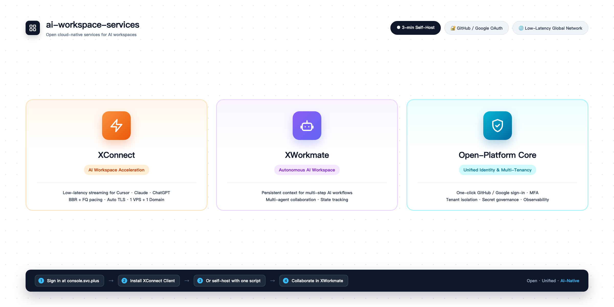
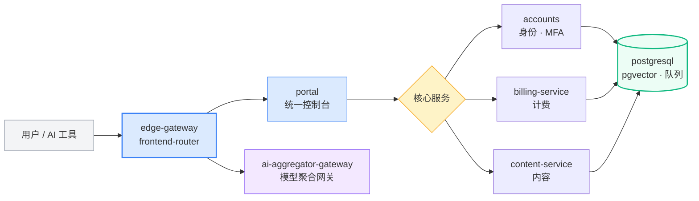

<!-- Target: ai-workspace-services/.github → profile/README_ZH.md (English default: profile/README.md) -->
<!-- Style mirrors ai-workspace-infra/.github profile/README.md. Spec: org-homepage-handoff.md -->

<p align="center">
  
</p>

<h1 align="center">ai-workspace-services</h1>
<p align="center"><strong>开放的 AI 云原生服务底座 | Open Cloud-Native Services for AI Workspaces</strong></p>

<p align="center">
  <a href="https://console.svc.plus"></a>
  <a href="https://github.com/ai-workspace-services"></a>
  <a href="https://github.com/ai-workspace-services?tab=repositories"></a>
  <a href="#-快速开始"></a>
  <a href="https://github.com/ai-workspace-services/accounts"></a>
</p>

<p align="center">
  <a href="https://github.com/ai-workspace-services">🌐 English</a> ｜ <strong>🇨🇳 简体中文</strong>
</p>

---

## 🇨🇳 组织概览

`ai-workspace-services` 是 AI Workspace Lab 的应用服务组织，构建在 [`ai-workspace-infra`](https://github.com/ai-workspace-infra) 基础设施之上。我们把统一身份、AI 协作工作空间与全球低延迟连接整合为云端托管或自建服务。

### 我们的产品准则

- **开放无锁定**：全部服务 Apache-2.0 开源，可自托管，可随时迁出。
- **身份统一**：一个账户贯通控制台、计费与所有产品，支持 GitHub / Google 一键登录。
- **低延迟优先**：面向 Cursor、Claude、ChatGPT 等 AI 工具的流式体验做网络优化。
- **多租户与可治理**：租户隔离、密钥治理与可观测性为默认能力。

### 常用访问入口

- **统一控制台**: [console.svc.plus](https://console.svc.plus)
- **知识库与文档**: [knowledge](https://github.com/ai-workspace-services/knowledge)
- **基础设施组织**: [ai-workspace-infra](https://github.com/ai-workspace-infra)
- **固定版本节点部署**: [PROD V4 一键部署 TL;DR](../docs/prod-v4-pinned-node-deployment-tldr.md)

---

## 🧩 三大核心产品 (Core Products)

<table>
<tr>
<td width="33%" align="center" valign="top">
  <h3>⚡<br/><a href="https://console.svc.plus/products/xstream">XConnect</a></h3>
  <p><strong>AI 工作空间加速连接</strong></p>
  <p align="left"><sub>为 AI 工具流式响应优化延迟，内核级 BBR + FQ，自动 TLS；支持 1 VPS + 1 域名自建或托管 SaaS。</sub></p>
</td>
<td width="33%" align="center" valign="top">
  <h3>🤖<br/><a href="https://console.svc.plus/products/xworkmate">XWorkmate</a></h3>
  <p><strong>自主 AI 协作工作空间</strong></p>
  <p align="left"><sub>持久上下文执行多步骤 AI 工作流，多 Agent 团队协作与状态追踪。</sub></p>
</td>
<td width="33%" align="center" valign="top">
  <h3>🛡️<br/><a href="https://console.svc.plus">Open-Platform Core</a></h3>
  <p><strong>统一身份与多租户核心</strong></p>
  <p align="left"><sub>GitHub / Google OAuth 一键登录，租户隔离、密钥治理与全链路可观测。</sub></p>
</td>
</tr>
</table>

---

## 🔀 服务架构 (Service Architecture)



---

## 🚀 快速开始

| 方式 | 适合 | 入口 |
| :--- | :--- | :--- |
| ☁️ **云端免运维** | 立即体验 | 访问 [console.svc.plus](https://console.svc.plus)，GitHub / Google 登录 |
| 📱 **跨平台客户端** | 日常使用 | [下载 XConnect 预览版](https://console.svc.plus/products/xstream)（macOS / Windows / iOS / Linux） |
| 🖥️ **自托管控制面** | 自建 Accounts、Billing、Console/Portal、Content 和 PostgreSQL | [部署与迁移指南](../docs/control-plane-deployment-and-migration.zh.md)，隔离联调验收待完成 |
| 🔌 **边缘节点接入** | 为已有控制面增加一个 XConnect 边缘节点 | 使用现有节点安装入口和节点凭据合同 |

| 脚本 | 用途 | 输入 |
| :--- | :--- | :--- |
| [`install-control-plane.sh`](../scripts/install-control-plane.sh) | 调用固定提交的 Playbooks | `--config`、完整 SHA 的 `--gitops-ref`、可选 `--check` |
| `migrate-core-data.sh` | 单向迁移核心数据，Accounts worker 负责，API 隔离验收待完成 | `MIGRATECTL_BIN` / `MIGRATECTL_SHA256`、源/目标 URL 与认证引用，默认预览 |
| [`setup-proxy.sh`](../scripts/setup-proxy.sh) | 边缘节点接入 | 保留当前 `--node` 等接口，脚本原样保留 |

从审核过的不可变 checkout 使用控制面候选入口：

```bash
export CONTROL_PLANE_CMDB='/secure/run/cmdb.json'
export CONTROL_PLANE_VARS_FILE='/secure/run/vars.yaml'
bash scripts/install-control-plane.sh \
  --config '<GitOps 相对 YAML>' --gitops-ref '<完整40位 SHA>' --check
```

包装脚本要求 Git、Python 3 和 PyYAML，获取 canonical GitOps 的固定提交及声明中的
`execution.playbooks_sha`。正式发布说明将提供固定脚本 URL；当前候选入口尚未标为运行可用。
`CONTROL_PLANE_VARS_FILE` 只放非敏感运行策略和 Vault 引用；凭据由 Playbooks owner 内部解析，不在该文件保存明文凭据。

```bash
# 边缘节点接入：替换为审核过的不可变 release 或完整 SHA。
curl -fsSL 'https://raw.githubusercontent.com/ai-workspace-services/.github/<release-or-SHA>/scripts/setup-proxy.sh' \
  | bash -s -- --node xhttp.example.com
```

八阶段：**1** GitOps 配置 → **2** IaC 与 CMDB → **3** 五仓构建快照 →
**4** 控制面安装 → **5** 核心数据单向迁移 → **6** 新环境完整验收 →
**7** 准备切换报告并等待确认 → **8** 经确认移交写入权、切流量及正式验收。

全新部署执行 1–4、6 并记录跳过迁移原因；代际升级执行全部阶段。
滚动更新采用备份、无破坏收敛及显式增量迁移；PostgreSQL 仅允许隧道访问。
五仓为 `accounts`、`billing-service`、`portal`、`content-service`、`postgresql`；
快照仅构建，不隐含部署授权。先预检 Actions/workflow 已启用。
r101 五仓 tag 均已创建，但 PostgreSQL dispatch 因 Actions 禁用返回 HTTP 422，构建未完成。
源码未变在原 tag 重试；仅代码/源码 SHA 改变时创建新不可变 revision，不移动已有 tag。

迁移 URL/API 模式等待隔离验收；现有 V4 尚无该 API，V4→V5 保留审核过的 SSH/数据库路径，URL 模式不隐式回退。
详见[指南及已有 V2/V3/V4 历史记录](../docs/control-plane-deployment-and-migration.zh.md#历史文档)。

---

## 📦 核心仓库矩阵 (10 Repositories)

| 仓库 (Repository) | 类型 / 定位 | 说明 / 功能特性 |
| :--- | :--- | :--- |
| [`portal`](https://github.com/ai-workspace-services/portal) | `Control Panel` | 开放云控制台，构建摆脱厂商锁定的“逃生舱” |
| [`accounts`](https://github.com/ai-workspace-services/accounts) | `Identity & Auth` | 生产级账户服务：认证、MFA 与 Agent 协同，svc.plus 生态核心 |
| [`billing-service`](https://github.com/ai-workspace-services/billing-service) | `Billing` | 计费与订阅服务 |
| [`content-service`](https://github.com/ai-workspace-services/content-service) | `Content API` | 内容管理与分发服务 |
| [`edge-gateway`](https://github.com/ai-workspace-services/edge-gateway) | `Edge Ingress` | 边缘入口网关 |
| [`frontend-router`](https://github.com/ai-workspace-services/frontend-router) | `Routing` | 前端路由与多站点分发 |
| [`ai-aggregator-gateway`](https://github.com/ai-workspace-services/ai-aggregator-gateway) | `AI Gateway` | AI 聚合网关契约、适配器与 Home-Lab 部署包 |
| [`postgresql`](https://github.com/ai-workspace-services/postgresql) | `Database & Vector` | PostgreSQL + 向量检索 + 中文分词 + 消息队列 |
| [`knowledge`](https://github.com/ai-workspace-services/knowledge) | `Knowledge Base` | 工程咨询、技术长文与 Workshop 文档资产 |
| [`.github`](https://github.com/ai-workspace-services/.github) | `Org Profile & CI` | 组织主页与发布状态自动化 |

---

## 🚦 发布状态 (Release Status)

下方 registry 发现结果仅表示构件存在，不证明部署成功或运行验收通过。

<!-- RELEASES:START — CI 生成，请勿手改 -->
| 环境 | 定位 | 状态 | 最新版本 | 更新时间 (UTC) |
| :--- | :--- | :--- | :--- | :--- |
| `prod` | 生产发布 |  | — | — |
| `uat` | 预发验证 |  | `uat-platform-rebuild-2026.07.27-r4` | 2026-07-27 05:38 |
| `sit` | 验证集成 |  | `4a7176c` | 2026-07-27 05:40 |

<details>
<summary>镜像清单 (Image Tags)</summary>

| 环境 | 镜像 | Tag |
| :--- | :--- | :--- |
| sit | console | `4a7176c` |
| uat | accounts | `ca13285` · `latest` |
| uat | billing-service | `uat-platform-rebuild-2026.07.27-r4` |
| uat | docs | `uat-platform-rebuild-2026.07.27-r4` |
| uat | postgresql | `uat-platform-rebuild-2026.07.27-r4` |

</details>
<!-- RELEASES:END -->

---

<p align="center">
  <strong>开放 · 统一 · 低延迟 · 可自建 · AI 原生</strong><br/>
  <sub>Open · Unified · Low-Latency · Self-Hostable · AI-Native</sub>
</p>
